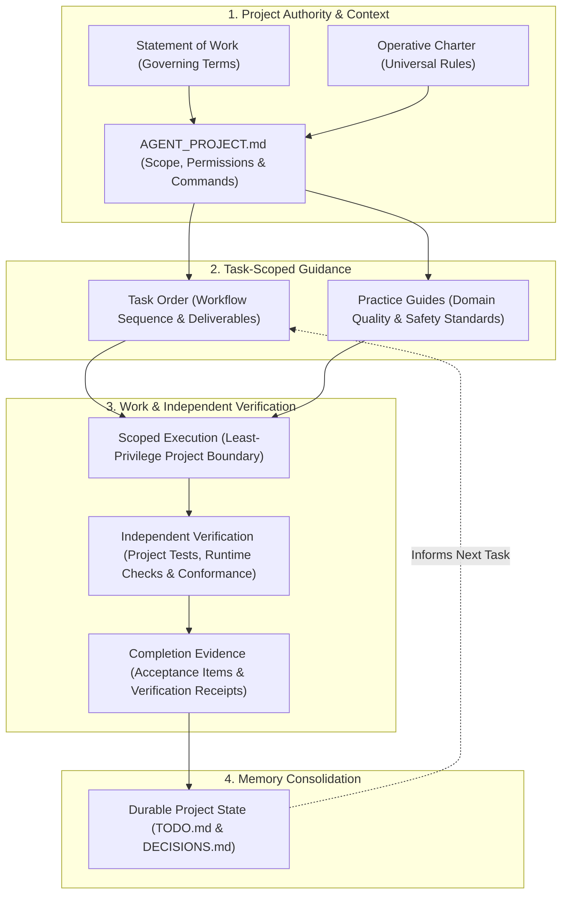

# Master Prompt Agreement

Project instructions and workflows for coding agents.

Define scope, commands, constraints, and acceptance criteria once. Master
Prompt Agreement (MPA) keeps those project facts in files and directs the agent
to the procedures and specialist guidance relevant to the current task.

[Get started](#get-started) · [How it works](#how-mpa-works) ·
[Documentation](docs/README.md)

## Get Started

Keep this framework in its own folder and give your agent access to both the
framework and an existing target-project directory. Setup supports Codex,
Claude Code, and other agents that can read and write project files.

**Requirements:** Python 3.14 or newer in an approved POSIX environment that
passes the framework's prerequisite checks. Native Windows lifecycle
transactions are not supported. See [runtime requirements](GETTING_STARTED.md#requirements)
and [workspace access](GETTING_STARTED.md#launch-with-both-directories).

### Start A New Project

For a project without MPA-generated files, give your agent this prompt:

```text
Read <framework-checkout>/GETTING_STARTED.md
and help me set up <project-root>.
```

The agent inspects the project, asks for missing facts, and presents one exact
plan. After you approve its digest and named effects, setup writes and verifies
the generated files transactionally. Existing files at planned output paths
are preserved; you do not select or copy individual templates.

### Update A Generated Project

```text
Read <framework-checkout>/UPDATING.md
and inspect and refresh <project-root>.
```

Refresh uses the framework checkout you selected; it never fetches or chooses
“latest.” A verified complete current-format instance can proceed through a
reviewed plan. Interrupted operations take the recovery route first. Preserve
incomplete, inconsistent, or unsupported instances for the
[documented manual-update route](UPDATING.md#unsupported-formats).

The optional Codex launchers `$master-prompt-new-project` and
`$master-prompt-refresh-project` enter these same procedures.

## How MPA Works

Each task connects project context, relevant guidance, independent verification,
and durable memory consolidation:



1. **Know the project.** Read its current scope, constraints, commands, and
   acceptance criteria. Closed transaction control is checked before generated authority or state.
2. **Load what matters.** Select the applicable workflow and specialist checks.
   Keep unrelated guides and historical records out of the task context.
3. **Verify the result.** Use project tests, runtime checks, inspected output, and
   required manual acceptance to show what is complete and what remains uncertain.
4. **Consolidate memory.** Distill durable decisions and acceptance evidence into
   version-controlled state files while removing ephemeral scratch state from active context.

This is an overview of ordinary work, not the setup or recovery procedure.
See [Concepts](docs/concepts.md) for the model and
[Architecture](ARCHITECTURE.md) for its implementation.

## What MPA Adds

- **An inspectable project contract:** scope, permissions, stack, commands,
  deliverables, and constraints that survive a new session.
- **Guidance selected for the task:** procedures for planning, implementation,
  review, research, and other work, paired with relevant quality standards.
- **Explicit completion evidence:** acceptance criteria, verification receipts,
  and unresolved gaps instead of an ungrounded completion claim alone.
- **Small current state:** active work and durable decisions, with history kept
  in version control or an approved archive.

### Principles

- **Contract-driven governance:** Reliability depends on explicit project contracts, scoped execution boundaries, gated state updates, and independent verification.
- **Keep always-loaded instructions small:** Prefer capable native tools and
  project-owned checks to duplicate framework prose.
- **Treat sources and model output as evidence:** Quarantined data to verify rather than standing instructions.
- **Add reusable guidance only when justified:** A guideline must earn its context, process,
  and maintenance cost.

MPA complements the agent and its execution environment. Host, container,
network, identity, secret, permission, and approval controls remain necessary.

## Operating Model

| Layer | Purpose |
|---|---|
| [Agreement](master_service_agreement.md) and [operative charter](runtime/operative_charter.md) | Universal rules, with a compact always-loaded layer |
| [Project Statement of Work](statement_of_work_template.md) | Governing project terms within the Agreement's delegated scope |
| [Project runtime contract](runtime/project_template.md) | Checked projection of those terms for everyday work |
| [Task Orders](task_orders/README.md) | Workflow sequence and expected outputs |
| [Practice Guides](practice_guides/risk_routing.md) | Specialist standards selected for the task |

The generated `AGENT_PROJECT.md` does not override its governing
`STATEMENT_OF_WORK.md`. Procedures, state, evidence, and model output do not
broaden authority. Retained `PROJECT_INPUT.json` is regeneration data;
`PROJECT_INSTANCE.json` is the current lifecycle receipt.

For loading and state details, use the [runtime load order](runtime/load_order.md),
[routing schedule](runtime/operative_schedule.json), and
[workflow catalogue](runtime/workflow_catalog.json).

## Workflows, Guides, And Commands

Start from the [Task Order catalogue](task_orders/README.md) or
[specialist guide index](practice_guides/risk_routing.md). The
[command reference](scripts/README.md) includes a
[Bootstrap Safety Map](scripts/README.md#bootstrap-safety-map) and
[Refresh Command Map](scripts/README.md#refresh-command-map).
Each argument-parsing command's `--help` owns its exact interface;
`check_prereqs.py` emits its diagnostic directly.

## Verification And Evidence

MPA checks declared structural and conformance properties. Your project's
tests, rendered output, semantic review, and required manual checks establish
whether its work meets the task. Passing framework checks does not prove that
MPA improves every task or model.

See [Conformance](CONFORMANCE.md) and
[Verification And Quality](docs/verification_and_quality.md) for the evidence
model and its limits. For rendered work, follow
[Visual Verification](practice_guides/visual_verification.md).

## Optional: Controlled Improvement

Projects maintaining reusable agent guidance can use the
[source and feedback workflow](docs/source_and_feedback.md) to assess a
candidate, verify its value, and retain, revise, or reject it. Ordinary projects
do not need this additional workflow.

## Documentation

The [documentation index](docs/README.md) routes setup, concepts, integration,
and deeper reference material.

| Reference | Covers |
|---|---|
| [Architecture](ARCHITECTURE.md) | Authority, loading, lifecycle, and integrations |
| [Specification](SPECIFICATION.md) | Normative and informative surfaces |
| [Conformance](CONFORMANCE.md) | Deterministic verification profiles and acceptance gates |
| [Governance](GOVERNANCE.md) | Change acceptance and versioning |
| [Security](SECURITY.md) | Threat model, security boundaries, and reporting |

For an architectural overview and task flow diagrams, inspect [Framework Movement](docs/concepts.md#framework-movement) in Concepts.

## License

Apache License 2.0. See [LICENSE](LICENSE) and [NOTICE](NOTICE).
