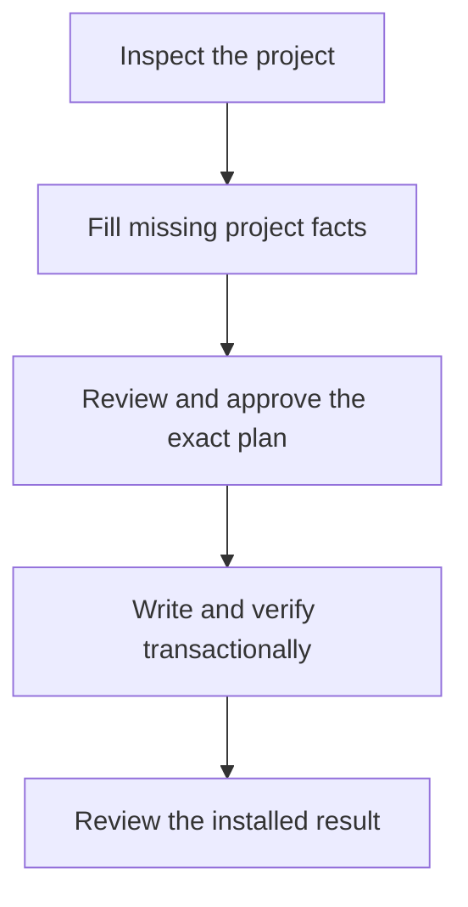

# Downstream Setup

Setup turns the project's facts into a small set of durable agent instructions.
Use this chapter for orientation, then follow
[Getting Started](../GETTING_STARTED.md) and the
[initialization Task Order](../task_orders/init.md) for the executable procedure.

## Setup Shape

1. **Inspect.** Give the agent read access to the framework and write access to
   the existing target directory. It checks the project's files and setup
   eligibility before asking questions.
2. **Complete the inputs.** Supply only missing facts. Temporary answers stay
   outside both repositories. An approved reusable profile may fill absent
   defaults; project answers replace its fields atomically. The profile does
   not establish project authority or execution capabilities.
3. **Review the plan.** Qualify the intended runner, generate a dry run, and
   review its rendered files, warnings, and effects. Approval binds to the exact
   plan digest, including when there are no warnings. Changed inputs or outputs
   require a fresh plan and approval.
4. **Write and verify.** The approved non-dry bootstrap runs one strict union of
   the receipt-listed active profiles inside the write transaction; any
   conformance warning or error fails the transaction and triggers rollback.
5. **Review the result.** Post-write human or manual review remains a distinct
   acceptance obligation; deterministic conformance does not replace it.
   Complete approved cleanup of temporary answers after that review. Do not
   immediately rerun the same conformance profiles; rerun conformance only for
   recovery verification, focused diagnosis, later drift, or independently
   requested evidence.

The [Bootstrap Safety Map](../scripts/README.md#bootstrap-safety-map) explains
the command boundary. Exact commands and arguments belong to
[Getting Started](../GETTING_STARTED.md), the
[Task Order](../task_orders/init.md), and executable help.

### Existing Or Interrupted Instances

Bootstrap creates a first current-format instance only when no generated
surface exists and no selected managed output path collides. Preserve ordinary
same-name files and use a reviewed non-colliding layout or project-specific
integration.

Complete current-format instances use [Updating](../UPDATING.md).
Partial, malformed, inconsistent, older, or unrecognized instances need its
reviewed manual-update route. A clearly newer format needs a supporting
framework checkout. Bootstrap rerender and state reset are not update paths.

If the project root contains `.mpa-bootstrap-recovery.json`,
`.mpa-bootstrap.lock`, or `.mpa-bootstrap-recovery.tmp`, stop ordinary work
before reading generated authority or state. Use bounded inspection and only
the exact-transaction-ID recovery action it reports as permitted. An incomplete
rollback retains a transaction control; it is not a successful setup.

## Generated Downstream Files

| File | Role |
|---|---|
| `STATEMENT_OF_WORK.md` | Governing project scope, commands, constraints, and acceptance criteria |
| `AGENT_PROJECT.md` | Checked runtime projection of the governing terms |
| `AGENTS.md`, `CLAUDE.md`, or another selected entrypoint | Runtime-specific loading and routing |
| `TODO.md` and `DECISIONS.md` | Active work and durable decisions |
| `PROJECT_INPUT.json` | Retained, fully materialized regeneration input |
| Project-root `PROJECT_INSTANCE.json` | Current instance receipt and location of the contract root |

The retained input contains project facts, including paths and commands. Keep
secrets out and review it before tracking, sharing, or publishing the project.
The framework checkout's ignore rules do not sanitize downstream repositories.
The receipt records current instance identity and the contract effective date;
it is not an update log.

Optional source, feedback, reviewer, security, precedent, and automation
surfaces are selected only when needed. Their active profiles are recorded in
the receipt. Inspect the relevant definitions in the
[answer schema](../examples/project_bootstrap_answers.schema.json) and use the
[minimal example](../examples/project_bootstrap_answers.example.json) as a
starting point; neither the complete schema nor output templates need to be
loaded into every agent context.

Refresh preserves retained mutable state byte-for-byte while regenerating
immutable outputs. Procedures may edit receipt-declared mutable state while
preserving its origin marker. Generated immutable procedures, including
`SOURCE_MONITOR_RESEARCHER.md`, change through refresh. Adding or retiring
optional surfaces also belongs to an exact approved refresh plan. Retirement
additionally requires the matching receipt partition, path-specific warning,
and applicable preimage controls. Do not create or hand-prune generated state
ad hoc.

## Stable Framework Reference

Use a stable `--framework-ref` when project files may be shared or published;
avoid personal absolute paths in shared entrypoints.

Select `--framework-revision-policy live` or `pinned` deliberately. A pinned
reference stays operator-fixed until a separate explicit revision-selection
action. A live reference can expose changed charter bytes before generated
files refresh. Neither policy fetches, installs, or chooses a newer checkout.

The project must also retain the exact runner, including the
compatible CPython interpreter and startup flags qualified by
`scripts/check_prereqs.py`. The SOW owns that requirement, and the generated
runtime contract reuses it without silently switching execution environments.
See [Updating](../UPDATING.md) for lifecycle details.

## Native Runtime Wrappers

Runtime-native wrappers are optional launchers, not workflow owners. The setup
wrapper enters `task_orders/init.md`; the refresh wrapper enters
`task_orders/framework_refresh.md` and never routes to initialization. Both
preserve the recovery gate and consult `GETTING_STARTED.md` or `UPDATING.md`
respectively for explanation, manual commands, or troubleshooting.
